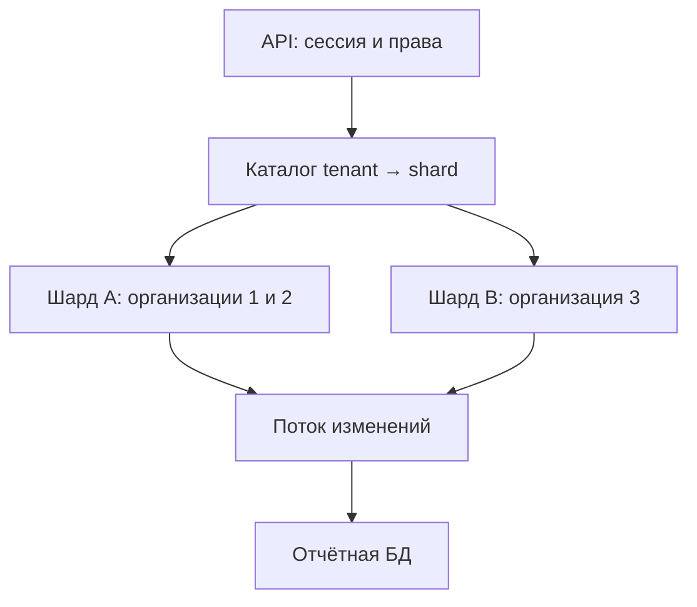

# Если БД пользователей выросла: что и как разделять

> Теги **[Факт]/[Рекомендация]/[Пример]/[Ограничение]** и ссылки вида `[S01]` расшифрованы в [методике](../00-methodology.md) и [реестре первичных источников](../sources/primary-registry.md).

**[Факт]** GitHub описывает логическое разделение связанных таблиц до физического [S03]. PostgreSQL поддерживает разбиение таблицы на партиции; это само по себе не готовый кластер с распределением записи по серверам [S10]. Далее — **[Рекомендации и учебная архитектура]**.

## Не начинайте с количества строк

Соберите пиковую нагрузку, p95/p99 критических запросов, планы выполнения, CPU, I/O, память рабочего набора, блокировки, число соединений, рост данных и лаг реплик. Проверьте N+1 и отсутствие пагинации. Отдельно измерьте стоимость экспорта и аналитики. Миллион небольших редко читаемых пользователей и миллион постоянно обновляемых балансов — разные системы.

| Мера | Какую проблему решает | Чего не решает |
|---|---|---|
| Индекс и изменение запроса | Лишнее сканирование/сортировка | Любой индекс добавляет работу при записи |
| Более мощный сервер | Нехватка ресурса одного узла | Общая область отказа и предел роста |
| Pool соединений | Слишком много соединений | Дорогие запросы и блокировки |
| Read replica | Допустимые несвежие чтения | Обычно не увеличивает ёмкость primary для записи |
| Партиции таблицы | Работа с ограниченным диапазоном, retention | Автоматическое распределение по независимым серверам |
| Вынос аналитики | Конкуренция отчётов с OLTP | Мгновенно согласованная копия всех данных |
| Разделение по доменам | Независимые группы таблиц и нагрузки | Транзакции и JOIN через границы |
| Шардинг | Распределение данных и записи | Горячий tenant, глобальные ограничения, простота эксплуатации |

После каждого шага повторяйте замеры. Нет обязанности пройти все ступени по порядку: диагноз определяет действие.

## Пример: multi-tenant CRM

Tenant — организация-клиент, а не отдельный менеджер. Учебные сущности:

- identity: глобальные user_id, учётные данные, членство user_id ↔ tenant_id;
- CRM: customers, deals, tasks, notes, каждая запись имеет tenant_id;
- directory: tenant_id → shard_id + routing_version;
- файлы: в объектном хранилище, права выдачи проверяет backend;
- отчёты: отдельное производное представление, не источник истины для прав.

Все связанные данные одной организации первоначально находятся на одном шарде. Это сохраняет локальные транзакции. Маршрутизация определяется сервером после проверки членства; tenant_id из запроса сам по себе не даёт доступ.

Указанные номера организаций условны. Каталог маршрутизации тоже нуждается в доступности, версиях и контроле устаревшего кэша.

## Выбор ключа

| Ключ | Когда подходит | Главная ловушка |
|---|---|---|
| tenant_id | CRM и B2B, операции внутри организации | Одна большая организация перегружает шард |
| user_id | Данные и транзакции принадлежат одному пользователю | Общие объекты требуют обращений к нескольким шардам |
| Время | События, история, удаление старых периодов | Самый новый период получает почти всю запись |
| География | Локальность и требования размещения | Перемещение пользователей и межрегиональные операции |

Не делите по имени, первой букве email или произвольному количеству пользователей. Для hash(key) % N изменение N перемещает большую часть распределения: нужны устойчивые виртуальные buckets или каталог размещения, а также процедура миграции. Hash не гарантирует равномерность нагрузки, даже если равномерно распределяет строки.

## Что меняется после разделения

Глобальный UNIQUE(email) не появляется автоматически на независимых шардах. Глобальную идентичность можно держать отдельно; локальные идентификаторы и ссылки часто включают tenant_id. Денежная транзакция между шардами требует отдельного дизайна — нельзя считать два COMMIT одной атомарной операцией.

Поиск по всем клиентам лучше обслуживать специальным индексом/проекцией с проверкой прав, чем выполнять fan-out по всем шардам на каждый экран. Удаление клиента должно доходить до проекций, файлов и кэша. Общая аналитика имеет собственную задержку обновления.

Горячий tenant сначала изолируйте на отдельный шард. Если и этого недостаточно, делить внутри него нужно по фактическим границам операций. Это усложнение оправдывают измерения, а не размер таблицы в одиночку.

## Перенос организации без потери записей

Это учебный runbook, не готовая инструкция для конкретной СУБД. Поэтапный принцип иллюстрирует Stripe [S05], но межсерверная согласованность требует отдельной реализации.

1. Проверить restore и зафиксировать контрольную позицию журнала. Создать совместимую схему назначения.
2. Организовать надёжную доставку изменений: CDC либо transactional outbox. Предусмотреть update, delete и порядок событий; потребитель идемпотентен.
3. Скопировать snapshot пакетами. Backfill не должен перезаписывать более новую версию строки.
4. Догнать изменения. Сверить не только число строк, но ключи, версии, контрольные суммы по диапазонам и бизнес-инварианты.
5. На короткое контролируемое окно остановить новые записи конкретного tenant и дренировать активные операции. Доставить финальный хвост журнала.
6. Атомарно переключить каталог маршрутизации; использовать fencing/version check, чтобы старый процесс не продолжил запись в прежнее место. Возобновить операции.
7. Наблюдать ошибки и корректность. Старую копию сохранить на согласованный период без второй независимой записи.
8. Удалять старое представление только после сверок и закрытия окна возврата.

**Откат:** до переключения можно отменить перенос. После новых записей в новом шарде простая смена адреса назад потеряет их. Нужны обратная синхронизация и сверка либо заранее выбранное исправление вперёд. Нельзя обещать «zero downtime» без проверенного протокола.

**Критерии остановки:** расхождение данных, неожиданная запись в старую копию, растущий лаг, исчерпание места, блокировки или нарушение SLO. Численные пороги назначаются до запуска по нагрузочному тесту.
